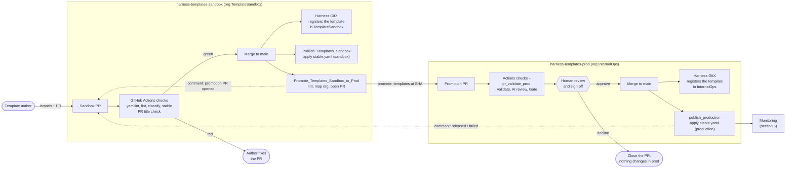
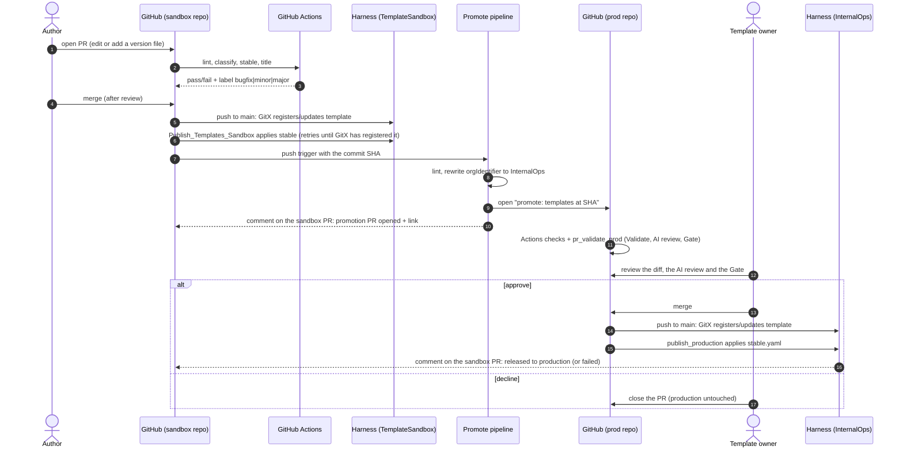
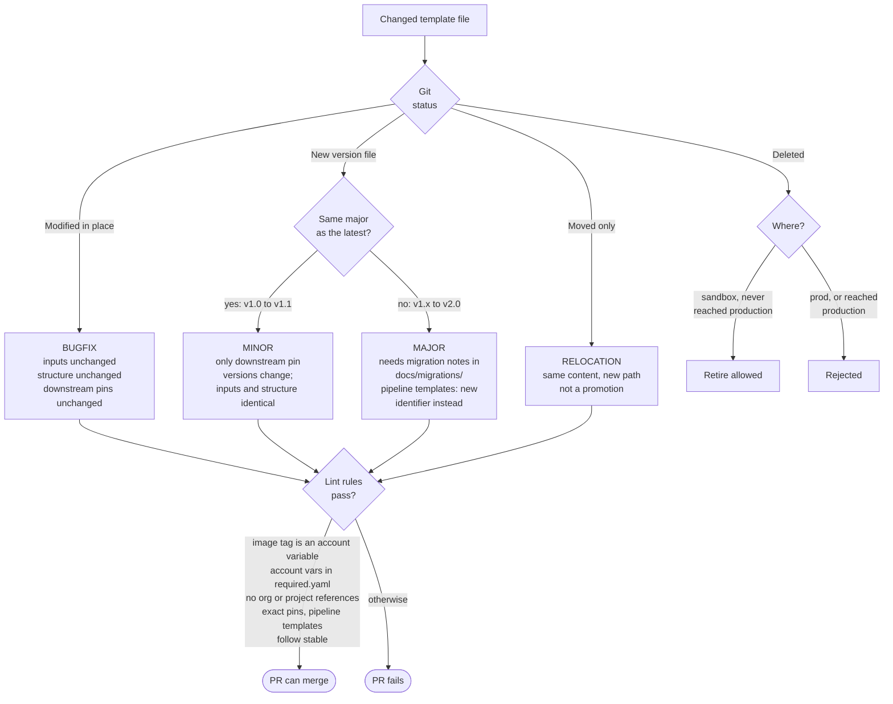
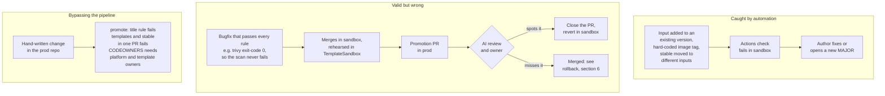
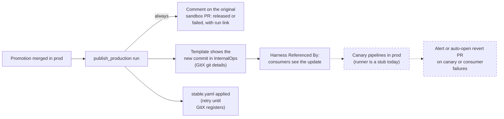
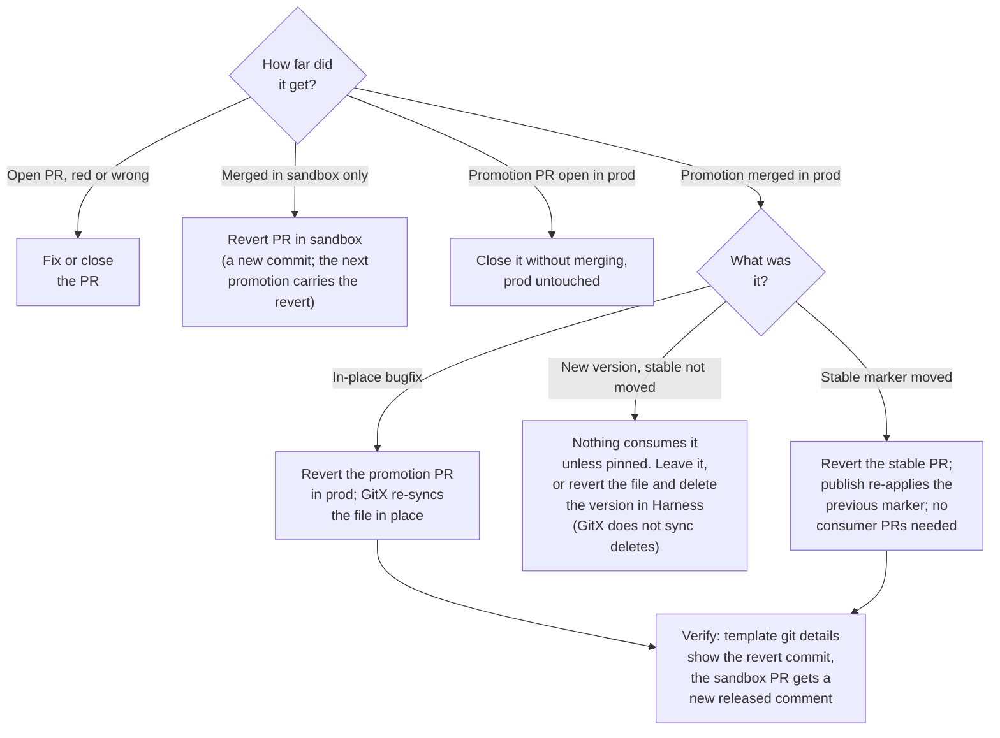

# Template promotion flow: from a person to production and back

How a template change travels, who or what acts at each step, how it is monitored, and how it is undone.
Companion to [PROMOTION-OVERVIEW.md](PROMOTION-OVERVIEW.md). Diagrams are Mermaid (GitHub renders them).

Legend used throughout: solid boxes exist today; **dashed boxes are planned or still demo-bypassed** (see the
shortcuts table in the overview).

## 1. End to end

Key rules the flow encodes:

- Nobody authors in the prod repo. Template content reaches prod only through a `promote: templates at <sha>` PR
  opened by the sandbox pipeline. The promotion is identified by the sandbox commit SHA.
- Nothing auto-merges. `auto_merge` is off; the human merge in prod is the release sign-off.
- Moving a **stable** marker is its own PR in prod (never in the same PR as the template that introduced the
  version), so each revert is clean.
- Harness **GitX** registers the files; our own `stable.yaml` + `set_stable.sh` decide which version is stable.

## 2. One promotion over time

## 3. What the checks decide

Every change to a template file is classified from the diff, and each class has hard limits. A violation fails the
PR in sandbox and again in prod.

Demo of the failing side: sandbox PR #16 (inputs changed in place + hard-coded image).

## 4. Bad paths

Demo of the middle path: sandbox PR #17 (`--exit-code 0`) and the resulting promotion PR in prod.

## 5. After promotion: feedback and monitoring

What exists today: the run result and the two comments on the sandbox PR, the template's git details in Harness
(commit id, file path), and the consumer registry (`registry/consumers.yaml`) for finding API callers that
*Referenced By* cannot see. What does **not** exist yet (dashed): the canary runner (`scripts/run_canaries.sh` is a
fail-closed stub, bypassed by `SKIP_CANARY`) and any automatic reaction to consumer failures after release.

## 6. Rollback

Pick the row by *how far the change got*.

Notes:

- **Stable is the consumer lever.** Pipeline templates follow stable, so moving stable back is the fast rollback;
  step and stage templates are pinned by consumers and are unaffected until a consumer changes its pin.
- **GitX does not delete.** Removing a version file from Git leaves the registered version in Harness. Delete
  non-stable versions first; the stable version cannot be deleted while others exist (the UI and API both refuse),
  and the last remaining version can be.
- **Reverts are ordinary PRs.** They go through the same checks. A revert that restores content classifies as a
  bugfix like the original change.
- **The CODEOWNERS sign-off still applies** to a revert of a promotion; there is no emergency bypass in this demo.

## 7. Who does what

| Step | Actor | Where it runs |
|---|---|---|
| Author, open PR | Template author | GitHub (sandbox repo) |
| Lint, classify, stable, title, label | GitHub Actions | GitHub |
| Register template | Harness GitX (org webhook) | Harness, org `TemplateSandbox` / `InternalOps` |
| Apply `stable.yaml` | `Publish_Templates_Sandbox` / `publish_production` + `set_stable.sh` | Harness, project `Template_Promotion_Management` |
| Open promotion PR, map org | `Promote_Templates_Sandbox_to_Prod` | Harness |
| Validate, AI review, Gate | `pr_validate_prod` | Harness, reported to GitHub as checks |
| Release sign-off | Platform + template owners | GitHub review/merge |
| Report back on the sandbox PR | `scripts/promotion_status.py` | both publish/promote pipelines |
| Account variables, roles, service accounts | `harness-account-iacm` | OpenTofu workspaces |
